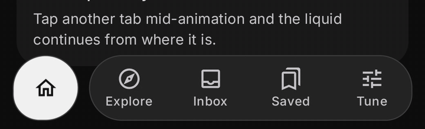
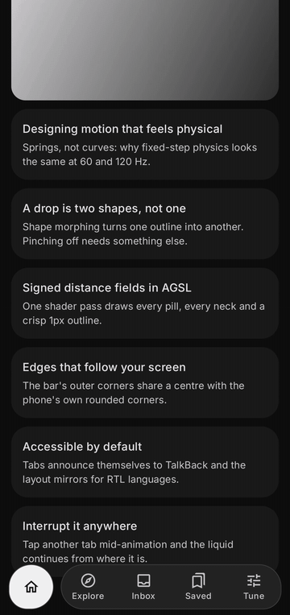
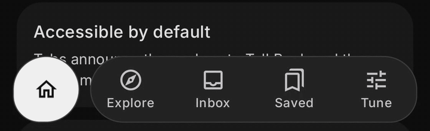

# Meniscus

**A Jetpack Compose bottom navigation bar whose selected tab pinches off like a drop of liquid.**

[](https://github.com/zainbits/meniscus/actions/workflows/ci.yml)
[](https://central.sonatype.com/artifact/io.github.zainbits/meniscus)

[](LICENSE)

<p align="center">
  
</p>

When you switch tabs, the new tab stretches away from its neighbours, the liquid neck between them thins and snaps, and the old tab flows back into the group. It is not a canned animation: the shape is computed every frame from spring physics and drawn by a single AGSL shader.

A *meniscus* is the curved surface of a liquid bridge between two drops. That curve is exactly what this library draws.

<table>
  <tr>
    <td align="center"><br><sub>Showcase app</sub></td>
    <td align="center"><br><sub>4x slow motion (system animation scale)</sub></td>
  </tr>
</table>

## Why another nav bar

Android's shape morphing turns one outline into another. A drop pinching off goes from **one shape to two**, which morphing cannot express, and the common blur-and-threshold "gooey" trick softens the edges and the icons. Meniscus draws the liquid bridge itself:

- **Real capillary-bridge geometry.** The neck between pills is made of circular fillets tangent to both caps, the shape a 2D liquid bridge takes. It thins faster just before it snaps, and a new bridge grows fast at first when two pills merge.
- **Frame-rate independent physics.** Exact closed-form damped springs on a fixed 500 Hz step, so the motion is identical on 60, 90 and 120 Hz screens. Tap another tab mid-animation and it continues from wherever it is.
- **Crisp rendering.** One AGSL signed-distance pass draws every pill, every neck and a 1 px outline that follows the neck, with analytic anti-aliasing. Icons and labels are normal composables above the shape, so they stay sharp. The draw path reuses its buffers instead of allocating each frame.
- **Fits the device.** The bar's outer bottom corners share a centre with the phone's physical rounded screen corners.
- **Accessible and international.** TalkBack announces tabs as tabs (`Role.Tab`, selectable group), RTL layouts mirror the bar, and the system animator duration scale is respected (0 jumps straight to the end state).
- **Small.** About 46 KB, depends only on Compose UI, Foundation and Material 3.

## Production use

Meniscus was extracted from two apps in daily use, where the same code has shipped since October 2026, and both now build against the library:

- [ZnKeyboard](https://github.com/zainbits/zn-keyboard), a privacy-respecting Android keyboard (settings app).
- Krewd, a self-hosted AI agent team with an Android client.

The engine is covered by JVM tests (spring accuracy against the closed-form solution, bridge tangency, 60/90/120 Hz equivalence, settling, interruption continuity and the animation-scale-0 snap), CI builds every change, and the public API is small and checked with Kotlin's explicit API mode.

## How it compares

There are good animated nav bars for Compose already. Here is where Meniscus differs, and where others are the better pick (checked November 2026).

| | Meniscus | Typical animated bars (exyte, canopas, SmoothBottomBar) | Blur-and-threshold "gooey" demos | Reactify | Glass libraries (Kyant Backdrop, Glasmio) |
| --- | --- | --- | --- | --- | --- |
| What moves | The selected pill detaches from the group; the neck thins and snaps | One indicator slides | Blurred blobs merge | Blob indicator blends into place | Glass lens follows the selection |
| Neck shape | Circular fillets tangent to both pills (2D liquid bridge) | None | Gaussian blur | Polynomial smooth-min | None |
| Edges and icons | Analytic 1 px edges, sharp icons | Sharp | Soft edges, blurred layer | Analytic edges | Sharp, refracted backdrop |
| Motion | Damped springs on a fixed 500 Hz step, velocity kept when interrupted | Time-based tweens | Varies | 450 ms linear tween, restarts on interrupt | Varies |
| Form | Complete bar | Complete bar | Demo code | Indicator on Material's bar | Framework or sample code |
| Min SDK | 33 | 24 to 32 | Varies | 24 | 21 to 33 |
| AAR size | about 46 KB | 124 to 137 KB | n/a | 168 KB | 131 KB to 5 MB |

Choose something else if you need Android 12 or older, glass blur and refraction, Compose Multiplatform, or extras like badges and hide-on-scroll. Choose Meniscus if you want the pinch-off itself, drawn crisply, in a small drop-in bar.

## Install

```kotlin
// build.gradle.kts
dependencies {
    implementation("io.github.zainbits:meniscus:0.1.0")
}
```

Requires `minSdk 33` (Android 13, the first version with `RuntimeShader`) and Jetpack Compose.

## Use

```kotlin
val items = listOf(
    MeniscusNavItem("Home", Icons.Outlined.Home),
    MeniscusNavItem("Explore", Icons.Outlined.Explore),
    MeniscusNavItem("Inbox", R.drawable.ic_inbox),   // drawable resources work too
    MeniscusNavItem("Profile", Icons.Outlined.Person),
)
var selected by rememberSaveable { mutableIntStateOf(0) }

Box(Modifier.fillMaxSize()) {
    Content(selected)

    MeniscusNavBar(
        items = items,
        selectedIndex = selected,
        onSelect = { selected = it },
        modifier = Modifier
            .align(Alignment.BottomCenter)
            .navigationBarsPadding()
            .padding(
                start = MeniscusNavBarDefaults.SideMargin,
                end = MeniscusNavBarDefaults.SideMargin,
                bottom = MeniscusNavBarDefaults.BottomGap,
            ),
    )
}
```

The bar floats, so let content scroll behind it and pad the end of lists by `MeniscusNavBarDefaults.Height + MeniscusNavBarDefaults.BottomGap` plus the navigation bar inset.

### Customise

```kotlin
MeniscusNavBar(
    items = items,
    selectedIndex = selected,
    onSelect = { selected = it },
    colors = MeniscusNavBarDefaults.colors(
        containerColor = MaterialTheme.colorScheme.surfaceContainerHigh,
        selectedContainerColor = MaterialTheme.colorScheme.primary,
        contentColor = MaterialTheme.colorScheme.onSurfaceVariant,
        selectedContentColor = MaterialTheme.colorScheme.onPrimary,
        borderColor = MaterialTheme.colorScheme.outlineVariant,
    ),
    labelStyle = MaterialTheme.typography.labelMedium,
)
```

Defaults follow your Material 3 theme, including dynamic color and dark mode.

## Showcase app and playground

- `sample/` is a small app with realistic screens behind the bar and live controls for tab count, palettes, dark theme and RTL. Run `./master.sh sample` with a phone connected.
- [`playground/index.html`](playground/index.html) runs the same engine and shader in a browser, for tuning the motion.

## How it works

1. `MeniscusModel` (pure Kotlin, no Android imports) lays out the pills and steps four kinds of springs: pill edges, the neck while it holds, the fast pinch after it breaks, and the color blend. Bonds break when a gap stretches past 60 % of its resting width and re-form below 70 % (hysteresis).
2. Each frame it writes slot edges and bridge geometry into two float arrays.
3. `MeniscusNavBar` passes them as uniforms to an AGSL shader that evaluates the union of rounded slots and capillary bridges as a signed distance field, then derives fill, outline and accent blend from it.

## Built with AI agents

Meniscus was built by [Zain Shaikh](https://github.com/zainbits) working with AI coding agents (OpenAI Codex and Anthropic's Claude Code). Zain set the goal and the design direction (real liquid physics instead of a canned animation), reviewed the work, and tested it on real devices in two apps. The agents researched the physics, wrote and tested most of the code, and extracted it into this library. Issues and pull requests are reviewed by a human.

## License

```
Copyright 2026 Zain Shaikh

Licensed under the Apache License, Version 2.0
```

See [LICENSE](LICENSE).
